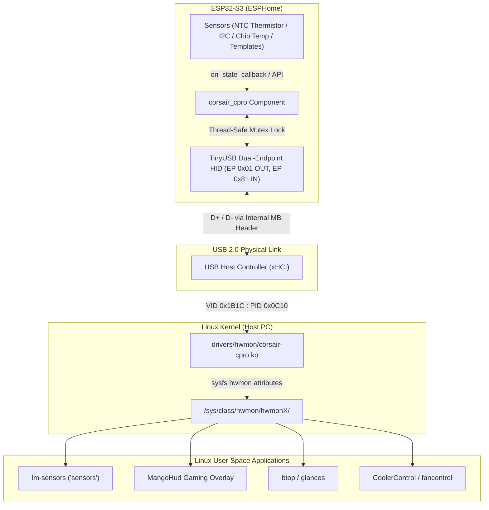

# ESP32-S3 Corsair Commander Pro (`corsair-cpro`) Emulation for ESPHome

Expose external PC sensors (custom water-cooling thermistors, chassis ambient probes, power rails, fan telemetry) directly to Linux hardware monitoring tools (**`lm-sensors`**, **`mangohud`**, **`btop`**, **`coolercontrol`**) natively through the Linux kernel's in-tree **`corsair-cpro`** module—**without any user-space daemons, Python scripts, or custom kernel drivers**.

---

## 1. The Need & Motivation

### The Problem
When monitoring PC temperatures with microcontrollers (like an ESP32), traditional approaches rely on:
1. **Generic USB HID Sensors (Usage Page 0x20):** Standard Linux distributions do not expose HID environmental sensors to `sysfs`/`hwmon` without custom user-space daemons (like `hid-sensor-daemon` or custom Python scripts) running with root or udev privileges.
2. **Serial / CDC COM Ports:** Requires background polling services to scrape serial text and pipe it into monitoring systems, which adds CPU overhead and fragile userspace dependencies.
3. **Wi-Fi / MQTT / Home Assistant:** Great for smart home dashboards, but introduces latency and external network dependencies, making it unusable for real-time PC cooling control (e.g. `fancontrol` or `coolercontrol`) or gaming overlays (like MangoHud).

### The Solution: Corsair Commander Pro Emulation
The mainline Linux kernel (since v5.9) includes **`drivers/hwmon/corsair-cpro.c`**, an official, in-tree hardware monitoring driver.

By advertising the USB Vendor ID (`0x1B1C`) and Product ID (`0x0C10`) of a **Corsair Commander Pro**, an ESP32-S3 connected to an internal USB motherboard header automatically binds to the kernel's native `corsair-cpro` module. The kernel immediately exposes:
* **4 Temperature Probes** (`temp1_input` – `temp4_input`) in millidegrees Celsius.
* **3 Power Rails** (`in0_input` 12V, `in1_input` 5V, `in2_input` 3.3V) in millivolts.
* **Up to 6 PWM Fan Channels** (`fan1_input` – `fan6_input`, `pwm1` – `pwm6`, `fan1_target` – `fan6_target`).

Running `sensors` natively reports:
```text
corsaircpro-hid-3-f
Adapter: HID adapter
in0:          12.18 V  
in1:           5.06 V  
in2:           3.33 V  
fan1 4pin:   1350 RPM
temp1:        +24.5°C  
temp2:        +55.9°C  
temp3:        +28.5°C  
temp4:        +33.2°C  
pwm1:             64%
```

---

## 2. Architecture & Data Flow



### Communication Protocol
The Commander Pro uses custom vendor HID reports without Report IDs:
* **HID Report Descriptor:** Vendor Page `0xFF00`, Usage `0x01`. Contains a **16-byte Input Report** (`Report Count 16`) and a **64-byte Output Report** (`Report Count 64`).
* **Endpoints:** Interrupt OUT (`0x01`, 64 bytes) and Interrupt IN (`0x81`, 64 bytes, 1 ms polling).
* **Command Sequence:**
  1. **Probe Handshake:** The kernel driver issues `0x10` (`CTL_GET_TMP_CNCT`), `0x20` (`CTL_GET_FAN_CNCT`), `0x02` (`CTL_GET_FW_VER`), and `0x06` (`CTL_GET_BL_VER`).
  2. **Telemetry Polling:** The host periodically queries channels via `0x11` (`CTL_GET_TMP`, channels 0–3, signed 16-bit big-endian in centi-°C) and `0x12` (`CTL_GET_VOLT`, rails 0–2 in mV).
  3. **Bi-directional Fan Control:** Host writes to `pwm*` or `fan*_target` send `0x23` (`CTL_SET_FAN_FPWM`) and `0x24` (`CTL_SET_FAN_TARGET`), enabling host-directed cooling control.

### Thread Safety & Hardware Identity
* **Multi-tasking Synchronization:** The TinyUSB stack runs inside `tinyusb_task`, while ESPHome sensor processing runs in `loopTask`. All telemetry registers are protected by a `std::mutex` to prevent torn reads.
* **Unique Serial Number:** The controller reads the hardware factory STA MAC address from eFuse (`esp_read_mac`) and populates the USB serial descriptor (e.g. `SerialNumber: 3C0F02DF7284`), guaranteeing persistent, collision-free `/sys/` device naming across reboots.

---

## 3. Hardware Hookup

### 1. USB Connection (Internal 9-Pin USB Header)
Connect the ESP32-S3 native USB pins directly to an unused 9-pin internal motherboard USB 2.0 header:

```
Motherboard USB Header (Pinout)       ESP32-S3 Dev Board
┌───────────────────────────┐         ┌────────────────────┐
│ [1] Pin 1: +5V (VBUS)     │────────>│ 5V / VIN           │
│ [3] Pin 3: USB D-         │────────>│ GPIO19 (USB D-)    │
│ [5] Pin 5: USB D+         │────────>│ GPIO20 (USB D+)    │
│ [7] Pin 7: GND            │────────>│ GND                │
│ [9] Pin 9: Key (No Pin)   │         └────────────────────┘
└───────────────────────────┘
```
> [!NOTE]
> Make sure to use the **Native USB** port (GPIO19/GPIO20) on your ESP32-S3 development board, not the auxiliary UART/USB-to-Serial chip port.

### 2. Temperature Probe Circuit (10K NTC Thermistor)
Standard 10K NTC thermistor (commonly used in PC water-cooling loops or air probes):

```
       3.3V
         │
         ├─── [ 10kΩ Pull-up Resistor ]
         │
         ├───> GPIO4 (ADC)
         │
         ├─── [ 10kΩ NTC Thermistor ]
         │
        GND
```

---

## 4. ESPHome Configuration & Usage

### File Structure
```text
corsair-cpro/
├── components/
│   └── corsair_cpro/
│       ├── __init__.py        # ESPHome component schema & code generation
│       ├── corsair_cpro.h     # USB descriptors, protocol macros & class definition
│       └── corsair_cpro.cpp   # TinyUSB driver hooks, mutex locks & command handlers
├── main.yaml                  # Main ESPHome device configuration
└── README.md
```

### Complete `main.yaml` Example

```yaml
esphome:
  name: pc-temp-sensor
  friendly_name: "Corsair Commander Pro"

esp32:
  board: esp32-s3-devkitc-1
  variant: esp32s3
  framework:
    type: esp-idf

# Pull in the local external component
external_components:
  - source:
      type: local
      path: components

# ── Corsair Commander Pro Component ────────────────────────────
# Directly binds ESPHome sensors to Commander Pro telemetry channels.
corsair_cpro:
  id: cpro_dev
  temp_1: temperature_sensor     # Channel 0: Water/Probe NTC
  temp_2: esp32_internal_t       # Channel 1: ESP32 CPU Die Temp
  temp_3: stub_temp_3            # Channel 2: Ambient Probe / Template
  temp_4: stub_temp_4            # Channel 3: GPU Backplate Probe / Template
  volt_12v: stub_volt_12v        # 12V SATA Power Rail
  volt_5v: stub_volt_5v          # 5V SATA Power Rail
  volt_3v3: stub_volt_3v3        # 3.3V SATA Power Rail
  fan_1_rpm: stub_fan_1_rpm      # Fan 1 Tachometer Reading

sensor:
  # ── Channel 1: External 10K NTC Probe ─────────────────────────
  - platform: ntc
    sensor: thermistor_resistance
    name: "Loop Water Temperature"
    id: temperature_sensor
    calibration:
      b_constant: 3950
      reference_temperature: 25°C
      reference_resistance: 10kOhm

  - platform: resistance
    id: thermistor_resistance
    sensor: thermistor_adc
    configuration: DOWNSTREAM
    resistor: 10kOhm

  - platform: adc
    id: thermistor_adc
    pin: GPIO4
    attenuation: 12db
    update_interval: 1s
    samples: 16

  # ── Channel 2: Real Internal Chip Temperature ─────────────────
  - platform: internal_temperature
    id: esp32_internal_t
    name: "ESP32 Internal Temperature"
    update_interval: 2s

  # ── Channels 3 & 4: Additional / Virtual Probes ───────────────
  - platform: template
    name: "Chassis Intake Temperature"
    id: stub_temp_3
    unit_of_measurement: "°C"
    update_interval: 5s
    lambda: |-
      return 28.5f;

  - platform: template
    name: "GPU Exhaust Temperature"
    id: stub_temp_4
    unit_of_measurement: "°C"
    update_interval: 5s
    lambda: |-
      return 33.2f;

  # ── Power Rail Telemetry ──────────────────────────────────────
  - platform: template
    name: "Power Supply 12V Rail"
    id: stub_volt_12v
    unit_of_measurement: "V"
    update_interval: 10s
    lambda: |-
      return 12.18f;

  - platform: template
    name: "Power Supply 5V Rail"
    id: stub_volt_5v
    unit_of_measurement: "V"
    update_interval: 10s
    lambda: |-
      return 5.06f;

  - platform: template
    name: "Power Supply 3.3V Rail"
    id: stub_volt_3v3
    unit_of_measurement: "V"
    update_interval: 10s
    lambda: |-
      return 3.33f;

  # ── Fan Tachometer Telemetry ──────────────────────────────────
  - platform: template
    name: "Radiator Fan Speed"
    id: stub_fan_1_rpm
    unit_of_measurement: "RPM"
    update_interval: 2s
    lambda: |-
      return 1350.0f;
```

### Imperative C++ API (Lambdas)
Any sensor or automation can also update values imperatively at any time:
```cpp
// Set temperature for channel 0..3 in degrees Celsius:
id(cpro_dev).set_temperature(0, 24.5f);

// Set voltage for rail (0 = 12V, 1 = 5V, 2 = 3.3V) in Volts or mV:
id(cpro_dev).set_voltage(0, 12.15f);
id(cpro_dev).set_voltage_mv(0, 12150);

// Set fan RPM for channel 0..5:
id(cpro_dev).set_fan_rpm(0, 1420);

// Read current PWM % commanded by the PC:
uint8_t target_pwm = id(cpro_dev).get_fan_pwm(0);
```

---

## 5. Linux Host Verification

### 1. Kernel Log (`dmesg`)
When plugged in or rebooted, the kernel binds immediately:
```bash
$ sudo dmesg | grep -i -E "corsair|commander"
usb 1-3: New USB device found, idVendor=1b1c, idProduct=0c10, bcdDevice= 1.00
usb 1-3: New USB device strings: Mfr=1, Product=2, SerialNumber=3
usb 1-3: Product: Commander PRO
usb 1-3: Manufacturer: Corsair
usb 1-3: SerialNumber: 3C0F02DF7284
corsair-cpro 0003:1B1C:0C10.000F: hidraw0: USB HID v1.11 Device [Corsair Commander PRO] on usb-0000:00:14.0-3/input0
```

### 2. CLI Hardware Monitoring (`sensors`)
```bash
$ sensors
corsaircpro-hid-3-f
Adapter: HID adapter
in0:          12.18 V  
in1:           5.06 V  
in2:           3.33 V  
fan1 4pin:   1350 RPM
temp1:        +24.5°C  
temp2:        +55.9°C  
temp3:        +28.5°C  
temp4:        +33.2°C  
pwm1:             64%
```

### 3. Direct sysfs Attributes
You can read or write sysfs nodes directly:
```bash
# Read temperature sensor 1 (reported in millidegrees C)
$ cat /sys/class/hwmon/hwmon6/temp1_input
24500

# Set fan 1 PWM duty cycle (0-255)
$ echo 180 | sudo tee /sys/class/hwmon/hwmon6/pwm1

# Set fan 1 target RPM
$ echo 1500 | sudo tee /sys/class/hwmon/hwmon6/fan1_target
```

---

## 6. Integration with Linux Tools

* **MangoHud:** Add `corsaircpro` sensors to your HUD overlay by specifying `pci_dev` or `hwmon` sensor path in `~/.config/MangoHud/MangoHud.conf`.
* **CoolerControl:** Fully graphical PC cooling and fan curve manager. CoolerControl auto-detects `corsaircpro` devices and lets you bind fan curves to custom ESP32 temperature probes.
* **fancontrol:** Part of `lm-sensors`. Configure `/etc/fancontrol` to adjust your chassis/radiator fans based on your custom liquid loop sensor.
* **btop:** Terminal resource monitor displaying CPU, GPU, and all `hwmon` sensor readings in real-time.

---

## 7. License
This project is licensed under the MIT License.
The Linux kernel driver `corsair-cpro.c` is licensed under GPL-2.0-or-later (Marius Zachmann).
